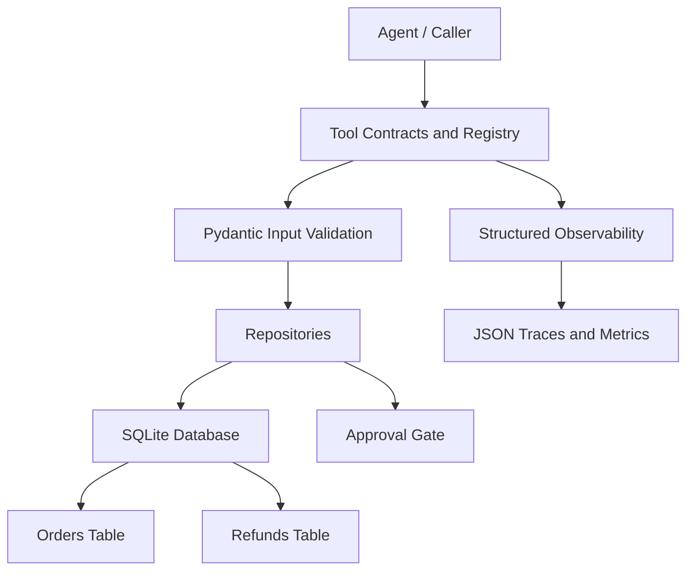

# Implement Databases Assessment

## Project Overview

This project demonstrates database-backed tool operations for an AI-agent workflow. It implements order lookup and a refund-request repository using SQLite, Pydantic input validation, a versioned tool registry, approval-gated refund status changes, structured logging, and evidence generation.

## Objectives

- Define explicit tool contracts, access modes, roles, and versions.
- Validate tool inputs and reject unexpected or malformed fields.
- Use parameterized SQL queries to avoid unsafe query construction.
- Persist orders and refunds in SQLite with primary-key, foreign-key, and check constraints.
- Keep refund requests pending until a separate approval operation is performed.
- Support transaction boundaries, nested transactions, and rollback.
- Produce structured JSON traces, test evidence, metrics, and an architecture diagram.

## Project Structure

```text
Implement_Databases_Assessment/
├── src/
│   ├── contracts.py
│   ├── database.py
│   ├── observability.py
│   ├── registry.py
│   ├── repositories.py
│   └── schemas.py
├── tests/
│   ├── test_task1_contracts_registry.py
│   ├── test_task2_database.py
│   ├── test_task3_security.py
│   └── test_task4_reliability.py
├── traces/
│   ├── req-001.json
│   ├── req-002.json
│   ├── req-003.json
│   ├── req-004.json
│   └── req-005.json
├── evidence/
│   ├── architecture.mmd
│   ├── generate_evidence.py
│   ├── metrics_summary.json
│   └── test_results.json
├── requirements.txt
└── .gitignore
```

## Main Components

### Tool Contracts and Registry
The contract layer defines access modes, tool specifications, calls, and results. The registry stores versioned tools and exposes registered tool metadata. The initial tools are `order_lookup` and `refund_request`.

### Database and Repositories
SQLite stores orders and refunds. The order repository retrieves an order using a parameterized query. The refund repository verifies the referenced order, prevents a refund amount from exceeding the order total, creates a pending request, and provides a separate approval operation.

### Validation and Security
Pydantic models reject extra fields and constrain order IDs, refund amounts, reasons, and approval identifiers. Database constraints protect referential integrity and allowed refund statuses. SQL values are passed as parameters rather than interpolated into query strings.

### Reliability and Observability
The database wrapper supports nested transaction scopes with savepoints. Structured events include request ID, tool name, status, duration when available, and an optional error type. Raw tool arguments are not included in these observability events.

### Evidence
The evidence generator runs representative success and failure scenarios, writes five JSON traces, records measured demonstration timings, stores the architecture diagram source, and executes the complete pytest suite to capture its actual result.

## Setup

Use Python 3.13 or a compatible Python version and run these commands from the project directory in Windows CMD:

```cmd
python -m venv .venv
.venv\Scripts\activate
python -m pip install -r requirements.txt
python -m pytest -q
```

Generate evidence:

```cmd
python evidence\generate_evidence.py
```

## Verified Test Results

The recorded evidence run completed successfully:

```text
..................................                                       [100%]
34 passed in 0.37s
```

The test suite contains 34 tests across tool contracts and registry, database operations, security validation, and reliability/observability.

## Demonstration Metrics

The recorded local evidence run contains five traces:

| Status | Count |
|---|---:|
| `ok` | 2 |
| `pending_approval` | 1 |
| `not_found` | 1 |
| `denied` | 1 |

- Average measured operation duration: 0.127 ms
- Maximum measured operation duration: 0.362 ms

These timings are local demonstration measurements and are not production performance benchmarks.

## Architecture



## Limitations

This is an educational demonstration using local SQLite data. It is not a production payment system. Production use would require authenticated identity and authorization enforcement at execution time, durable approval records, idempotency controls, stronger operational monitoring, deployment configuration, and integration testing against the chosen database and payment provider.

## Reflection

Building this assessment helped me connect tool design with the persistence and safety requirements of a database-backed agent workflow. I started by defining explicit contracts and a registry so tools had clear names, versions, access modes, and validation models. This made the interface easier to inspect and test before adding database behavior.

The SQLite layer gave me practical experience with relational constraints, parameterized queries, and repository boundaries. I learned that a successful database call is not enough on its own: inputs must be validated, missing records must be handled predictably, and write operations need clear transaction semantics. The refund workflow also reinforced the importance of separating a request from its approval. Supplying an approval-like value to a request should not automatically authorize the operation.

The security tests made these rules concrete. They check malformed identifiers, unexpected fields, invalid amounts, missing orders, invalid foreign keys, and disallowed statuses. During reliability testing, the rollback test exposed a transaction-boundary issue: a repository operation was committing before an enclosing operation could roll back. Updating the database wrapper to support nested transactions and savepoints helped make the intended boundary explicit.

I also added structured observability and generated evidence from real local execution. The traces show representative success, pending-approval, not-found, and denied outcomes, while the metrics file records measured durations and the test runner's actual output. These timings are useful for confirming that the evidence pipeline works, but they should not be interpreted as production benchmarks.

Overall, this project strengthened my understanding of how contracts, validation, database constraints, approval gates, transactions, and evidence work together. My main takeaway is that reliable tool calling depends on explicit boundaries and verifiable behavior, not just on making a database query succeed.
